

  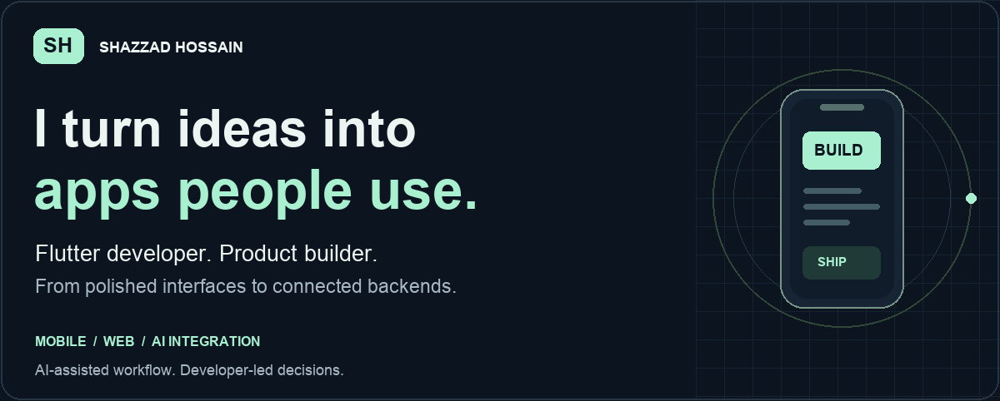

  <a href="#selected-work">Selected work</a> &nbsp; / &nbsp;
  <a href="#toolbox">Toolbox</a> &nbsp; / &nbsp;
  <a href="#demos--more-work">Demos</a> &nbsp; / &nbsp;
  <a href="https://www.upwork.com/freelancers/~0166604c45ec612f0e">Work with me ↗</a>

 

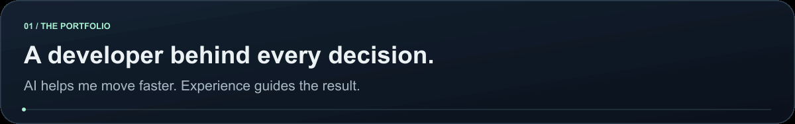

I'm **Shazzad Hossain**, a Flutter developer who builds mobile apps, connects backends and takes unfinished products toward release. I work across **Flutter, React Native, Laravel and PHP**, with a practical understanding of the web stack.

AI is part of my daily workflow: I use it to explore, build and debug faster, then review the code, test the behavior and make the implementation decisions. My focus is a working product and a clear handover.

 

## Selected work

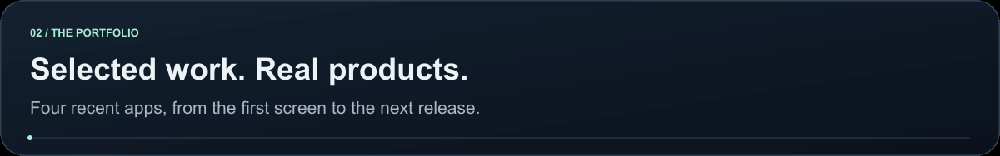

<a href="https://apps.apple.com/us/app/groc-nutrition-label-scanner/id6755927614">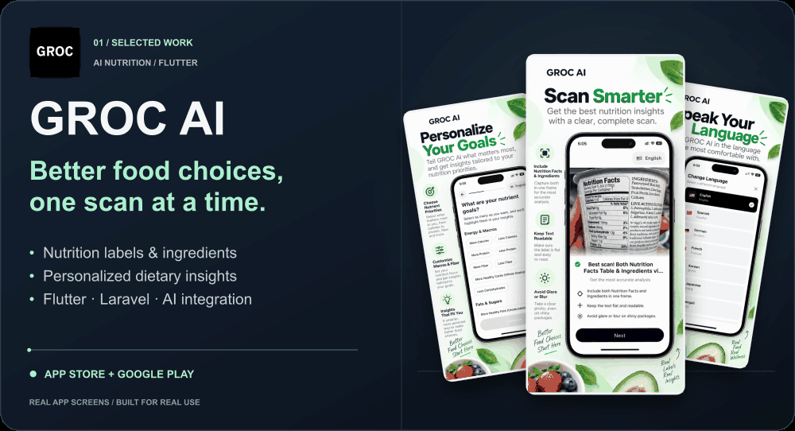</a>

**[App Store ↗](https://apps.apple.com/us/app/groc-nutrition-label-scanner/id6755927614)** &nbsp; · &nbsp; **[Google Play ↗](https://play.google.com/store/apps/details?id=app.thinka.groc)** &nbsp; · &nbsp; [Full-resolution preview](assets/groc-showcase.png)

 

<a href="https://apps.apple.com/us/app/klod-ai-virtual-try-on/id6762509336">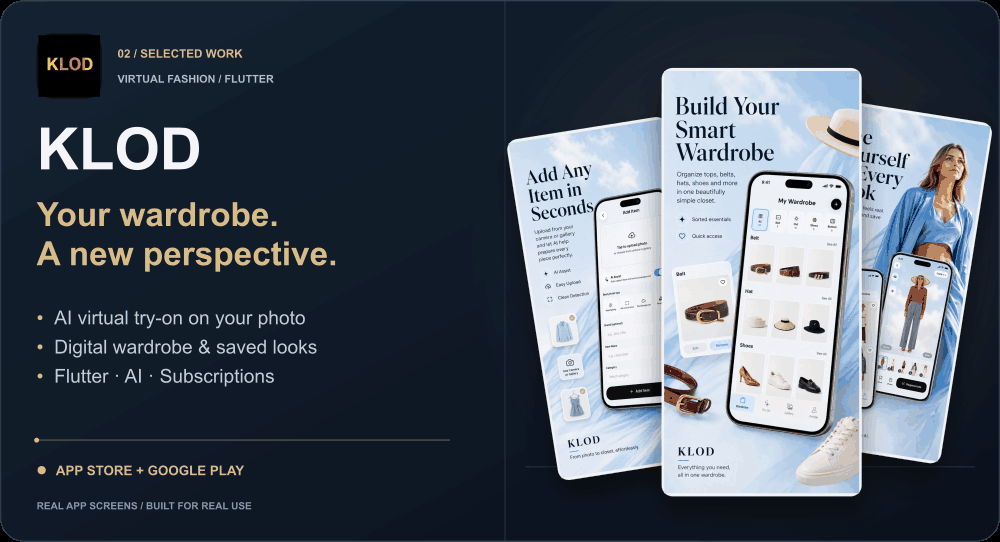</a>

**[App Store ↗](https://apps.apple.com/us/app/klod-ai-virtual-try-on/id6762509336)** &nbsp; · &nbsp; **[Google Play ↗](https://play.google.com/store/apps/details?id=app.thinka.klodmain)** &nbsp; · &nbsp; [Full-resolution preview](assets/klod-showcase.png)

 

<a href="https://apps.apple.com/us/app/readlens-ai-text-analyzer/id6761712530">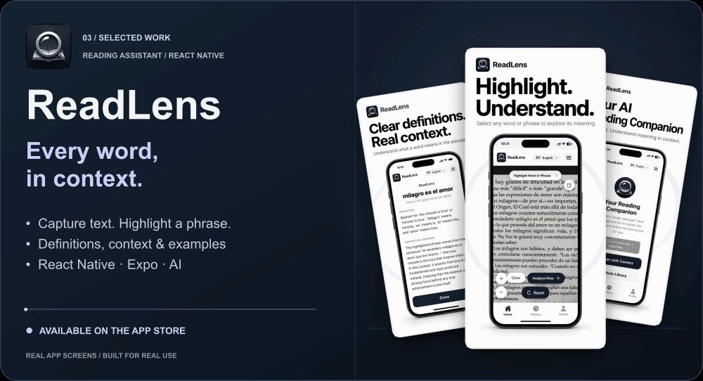</a>

**[App Store ↗](https://apps.apple.com/us/app/readlens-ai-text-analyzer/id6761712530)** &nbsp; · &nbsp; [Full-resolution preview](assets/readlens-showcase.png)

 

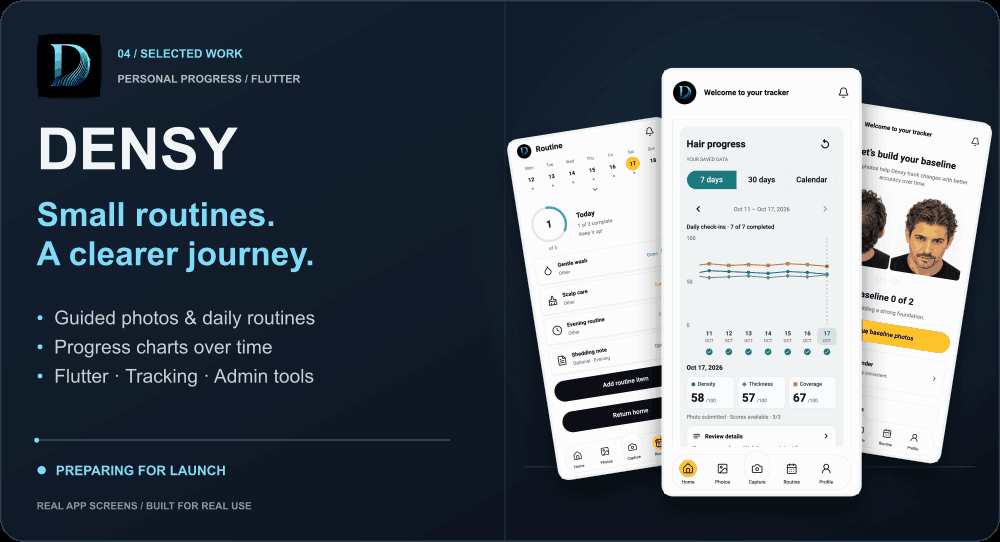

**Preparing for launch** &nbsp; · &nbsp; Store link coming after release &nbsp; · &nbsp; [Full-resolution preview](assets/densy-showcase.png)

 

## What I can help you build

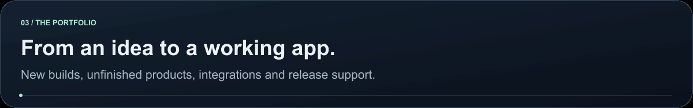

| Your project needs | How I can help |
| :--- | :--- |
| **A mobile app from an idea or design** | Flutter UI, features, navigation and backend connections for Android and iOS. |
| **An unfinished or AI-generated app** | Review the existing code, fix broken flows and complete missing features. |
| **Connected product features** | Authentication, REST APIs, Firebase, AI services, notifications and subscriptions. |
| **A backend or admin dashboard** | Laravel/PHP APIs, app management tools and connected web interfaces. |
| **A reliable next release** | Bug fixes, affected-flow testing, store builds and release preparation. |

 

## Toolbox

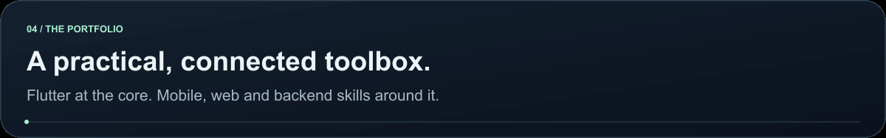

**Core focus** &nbsp; Flutter · Dart · Firebase · REST API integration 
**Also work with** &nbsp; React Native · Expo · Laravel · PHP · HTML · CSS 
**Foundational knowledge** &nbsp; JavaScript · Node.js 
**Everyday workflow** &nbsp; Git · GitHub · Android Studio · Xcode · AI-assisted development

 

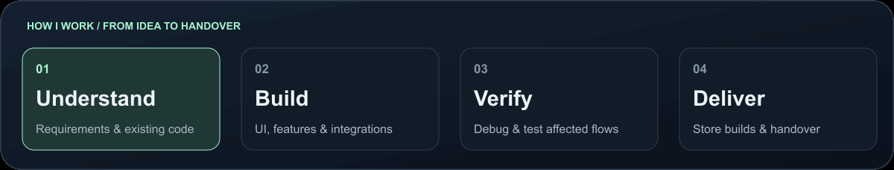

 

## Demos & more work

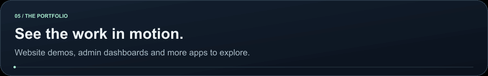

**[Watch website demos ↗](https://www.youtube.com/watch?v=5krdn9JUgvQ&list=PLYxyiUXhaAEs)** &nbsp; · &nbsp; **[Watch admin dashboard demos ↗](https://www.youtube.com/watch?v=yLp8FOYTnjI&list=PLBmGb1G_Iox4)**

<b>Explore more apps and public code</b>

 

More apps in my portfolio: [NightWatch](https://play.google.com/store/apps/details?id=com.nightwatch.nightwatchag), [NightWatch Admin](https://play.google.com/store/apps/details?id=com.nightwatch.nightwatchadminag), [Night Watch Responders](https://apps.apple.com/us/app/night-watch-responders/id6743240812), [Dirham](https://apps.apple.com/app/dirham/id6743340811), [SnapVoice AI](https://play.google.com/store/apps/details?id=com.snapvoiceai.app) and [ClickingShop](https://apps.apple.com/us/app/clickingshop/id6742814884).

Public Flutter projects and learning explorations:

- [Background Remover](https://github.com/shazzadshojol/bg_remover) — API integration and state management explorations.
- [Task Manager](https://github.com/shazzadshojol/task_manager_app) — task management and REST API integration.
- [E-commerce Project](https://github.com/shazzadshojol/ecommerce_project_ostad) — Flutter e-commerce coursework from Ostad.

[Browse all public repositories ↗](https://github.com/shazzadshojol?tab=repositories)

 

<a href="https://www.upwork.com/freelancers/~0166604c45ec612f0e">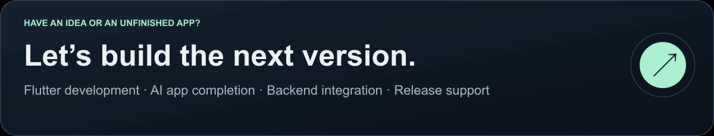</a>

  <a href="https://www.upwork.com/freelancers/~0166604c45ec612f0e"><b>Discuss a project on Upwork ↗</b></a>
  &nbsp; · &nbsp;
  <a href="https://www.linkedin.com/in/shazzad-flutter-apps-developer/">Connect on LinkedIn ↗</a>

